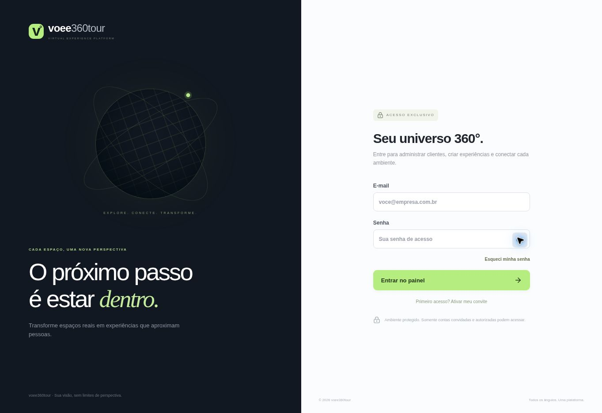
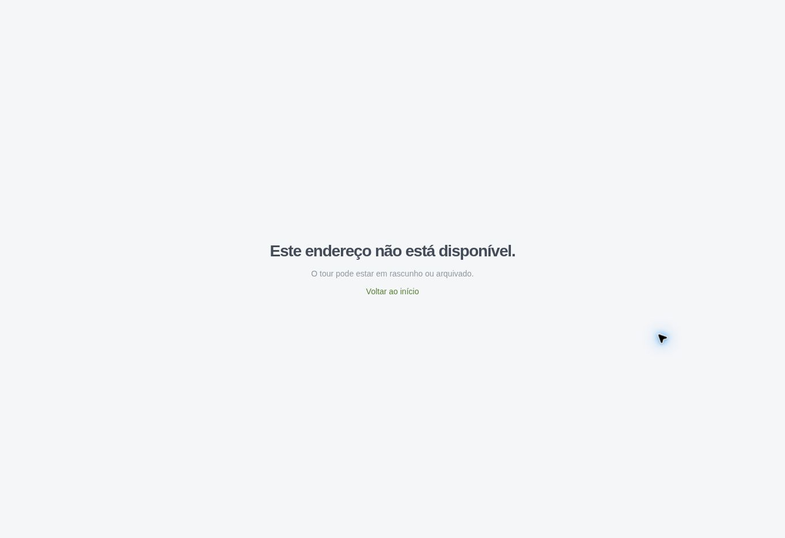
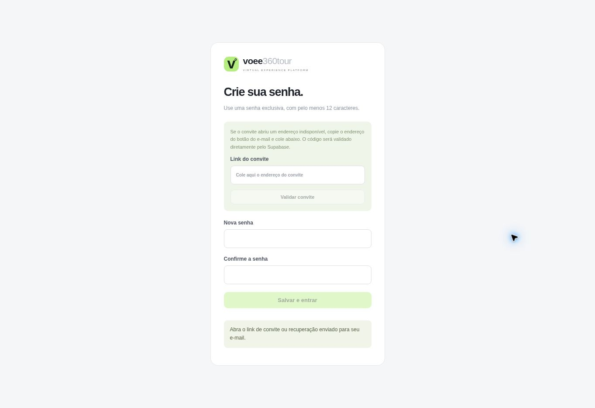

# Auditoria voee360tour — Cloudflare

Data: 29/10/2026 (America/Sao_Paulo). Endereço: https://voee360tour.webluxfloripa-lab.workers.dev/

As correções técnicas foram publicadas no Worker. A navegação do Nostro Fumo está incompleta e permanece pendente. A sessão administrativa não foi autenticada nesta execução.

## Fluxos observados no navegador

| Etapa | Verificação | Estado |
| --- | --- | --- |
| 1 | Entrada, tela de login, mostrar/ocultar senha e recuperação com e-mail vazio | Funcionando; mensagem de orientação exibida sem enviar e-mail |
| 2 | Acesso direto a `/admin/projetos` sem sessão | Bloqueado: retorna ao login |
| 3 | `/t/seven-sports-bar` | Indisponível ao público, coerente com o estado de rascunho; reconferido após o deploy |
| 4 | `/definir-senha` sem convite/sessão | Salvar senha desabilitado; convite exigido |

### 1 e 2 — login e proteção administrativa

A tela carregou e hidratou; os controles mostrar/ocultar senha responderam. A visita direta ao painel sem sessão voltou ao login. Não foi digitada nem redefinida senha. As capturas não comprovam conformidade completa de acessibilidade. Os textos auxiliares pequenos e claros merecem teste de contraste e legibilidade em celular; esse teste não foi realizado nesta execução.

### 3 — tour em rascunho

O banco confirma zero publicações. O domínio inicial abre a plataforma administrativa; não escolhe nem publica automaticamente um cliente.

### 4 — convite obrigatório

O botão de salvar permanece desabilitado sem sessão válida. Não foram enviados convites nem e-mails.

## Dados e conexões

Inventário consultado no Supabase real antes e depois da implantação:

| Projeto | Ambientes | Arquivos | Setas | Resultado da auditoria estrutural |
| --- | ---: | ---: | ---: | --- |
| Seven Sports Bar | 22 | 44 | 50 | 22 ambientes alcançáveis; 25 conexões de ida/volta; sem erros ou avisos estruturais |
| Nostro Fumo | 8 | 16 | 1 | Apenas 2 ambientes alcançáveis; 6 isolados; uma seta sem retorno |

A única seta do Nostro Fumo liga `20876` a `20875`. Faltam as ligações dos ambientes `20874`, `20873`, `20872`, `20871`, `20870` e `20869`, além da volta. Não foram inventadas posições de setas: a configuração precisa de conferência visual das passagens nos panoramas. A auditoria estrutural não prova o alinhamento físico das 50 setas do Seven.

Os dois projetos permanecem em rascunho. Nenhum snapshot, versão, publicação ou arquivo de mídia foi alterado por esta auditoria. Todas as 12 tabelas públicas estão com RLS habilitado.

## Correções implementadas

- Renovação dos links assinados de mídia no visualizador público e no iframe antes de expirarem; nova tentativa ao retornar à aba e pelo botão de recuperação. O ambiente atual e a preferência de pausa são preservados.
- A falha de inicialização do script Pannellum deixa de reaproveitar uma Promise rejeitada, permitindo outra tentativa de carregamento.
- Erros individuais ao assinar imagens passam a ser comunicados, mesmo quando o lote retorna sem erro geral.
- Menu de ambientes identificado como diálogo, com gestão de foco e fechamento por Escape usando o padrão existente da aplicação.
- Empacotamento reproduzível para Cloudflare incluído no código; cabeçalhos de segurança e proteção do painel mantidos. Respostas dinâmicas sem política explícita passam a usar `no-store` para não conservar links de mídia expirados em cache.

## Validação

- TypeScript e ESLint: aprovados.
- Vitest: 28 testes aprovados em 7 arquivos, incluindo renovação após 46 minutos simulados, recuperação de mídia, preservação da cena/pausa, fechamento do menu e recuperação do carregador.
- Banco local PGlite: 17 verificações aprovadas, incluindo histórico, restauração, publicação atômica e isolamento de projetos. Não foi executada publicação de teste no banco real.
- Builds Node e Cloudflare aprovados.
- Worker empacotado executado localmente: login 200; tours em rascunho, slugs inválidos e imagem de tour não publicado com 404; todos os 36 arquivos estáticos com 200 e tipo esperado; HEAD 200, ETag 304 e método não permitido 405.
- Cloudflare confirmou implantação da versão `8a59fbdf-cc56-4b32-bed3-ba24ea5d093e` com 100% do tráfego e inicialização de 17 ms. Isso é tempo de inicialização do Worker, não uma medição de carregamento para usuários.
- Em produção, login 200 com `private, no-store`, `X-Frame-Options: DENY`, CSP, HSTS e `nosniff`; interações de login e tela de convite reconferidas no navegador.
- Uma verificação HTTP com Python recebeu 403; a verificação com curl e o navegador acessaram o login normalmente. Não foi classificado como indisponibilidade do site. A matriz completa de HTTP em produção não foi considerada aprovada por esse teste.

## Pendências e limites

1. Concluir visualmente as conexões do Nostro Fumo no editor autenticado. Nenhuma posição de retorno foi inferida automaticamente.
2. Validar uma sessão real da administradora e os fluxos de edição, upload, salvamento e histórico pelo navegador. Não houve sessão autenticada nem teste mobile/WebGL completo nesta execução.
3. Configurar Workers Builds para acompanhar `main` no GitHub. O Worker não tem gatilho nem configuração de build vinculados. A revisão automática bloqueou a consulta ao endpoint de tokens de build por envolver credenciais; esse endpoint não foi consultado por outro caminho. Não foram criadas credenciais ou prometidas atualizações automáticas.
4. O advisor do Supabase registra proteção contra senhas vazadas desabilitada. Nenhuma mudança de plano ou configuração de Auth foi aplicada. Referência: https://supabase.com/docs/guides/auth/password-security#password-strength-and-leaked-password-protection

## Recuperação

Versão anterior do Cloudflare preservada: `4183483b-bcde-4d87-be7a-a89c9719fd5f`. Branch de recuperação do código: `recovery/pre-cloudflare-audit-20261029`, no commit `9fba7b30b9bab7176e86ad5d22a0827611422052`.

Referência do preset utilizado: https://nitro.build/deploy/providers/cloudflare
