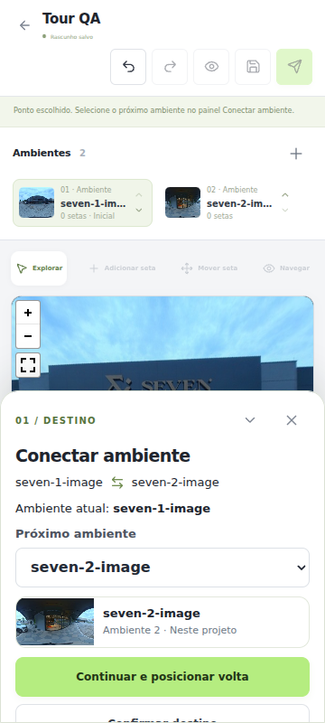
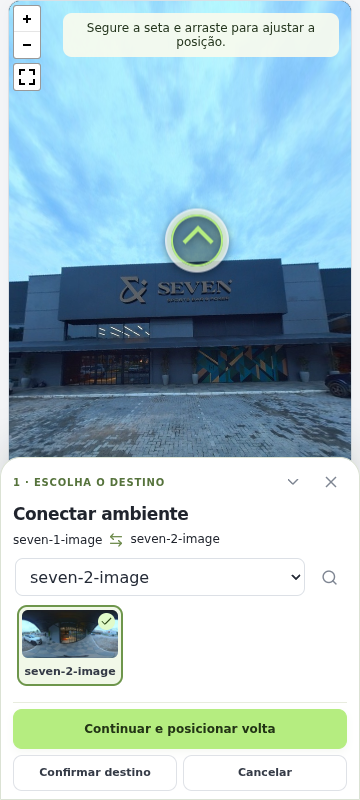
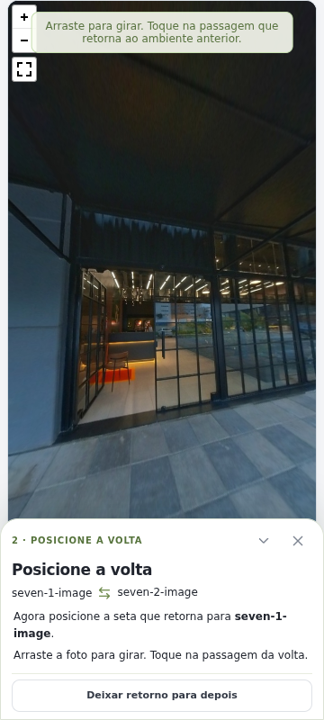
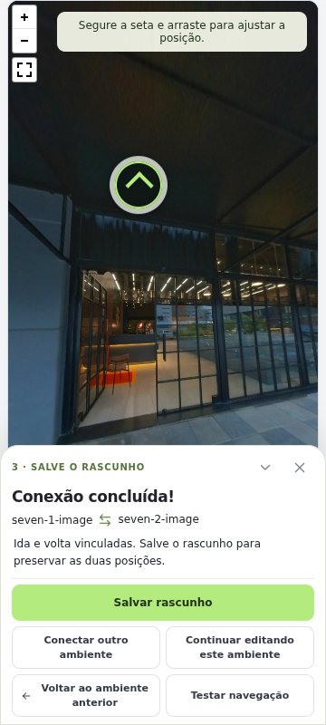
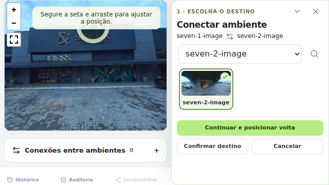

# Editor mobile: conexão visual e ajuste das setas

Revisão do editor existente, em `feat/mobile-connections`, a partir de `main` `98ff32c5b40a1fcf25fd95ab40903da9dabf5e2c`. Objetivo: operar o tour no celular com a fotografia visível, reconhecer o destino pela imagem e ajustar cada direção sem perder o par.

## Auditoria e correções

| Etapa | Problema observado | Correção e estado verificado |
| --- | --- | --- |
| 1. Marcar a passagem | Cabeçalho de duas linhas, lista de ambientes e controles consumiam grande parte da tela. O texto dos modos era pequeno. | Cabeçalho compacto com Salvar identificado, modos com ícones e nomes legíveis, foto priorizada durante a conexão e instrução junto ao panorama. |
| 2. Escolher o ambiente | O seletor textual dificultava reconhecer fotos com nomes semelhantes. As ações podiam exigir rolagem no painel. | Miniaturas clicáveis com seleção destacada, busca por nome/grupo, seletor acessível por teclado e ações fixas fora da rolagem do conteúdo. A origem é excluída. |
| 3. Posicionar a volta | O retorno dependia do toque correto e de trocar de modo para ajustes. | Destino abre automaticamente. A pessoa gira a foto e marca a passagem real. Pode segurar e arrastar a seta proposta ou a volta, antes de confirmar. Não há coordenadas inventadas. |
| 4. Conferir e salvar | A ligação precisava manter duas posições independentes e não se confundir com publicação. | Conferência da ida/volta, conclusão explícita e Salvar rascunho. Preserva pairId, desfazer/refazer, retorno pendente e histórico existentes. Não publica o tour. |
| 5. Celular deitado | Na auditoria intermediária, o painel inferior deixava apenas cerca de 46px de foto visível em 640×360. | Painel lateral nesse formato, com foto ao lado e ações acessíveis. Regressão específica mede a área disponível e a ausência de rolagem horizontal da página. |

## Evidência visual

Capturas da execução atual com fotografias reais do kit e projeto de teste em memória. Não representam uma sessão autenticada da titular nem alterações nos clientes existentes.

Antes: o painel e o cabeçalho deixavam pouca fotografia visível.

Depois: destino visual, seleção destacada, mais fotografia e ações acessíveis.

Volta: o destino é aberto e a passagem é marcada visualmente.

Conclusão: as duas direções estão vinculadas e aguardam salvamento.

Celular deitado: painel ao lado da fotografia.

## Gestos e segurança da edição

- Toque curto na seta seleciona. Segurar por 350ms ativa o arraste, com destaque visual. O modo Mover seta mantém o arraste direto.
- O gesto usa captura do ponteiro; não gira a câmera por baixo da seta. Arrastar a fotografia continua girando a câmera e não insere uma seta ao soltar.
- Soltar confirma uma mudança de posição no histórico. Cancelamento do ponteiro descarta a movimentação visual e preserva as coordenadas anteriores.
- O ponto temporário da ida e a volta em conferência podem ser ajustados sem gravar ligações acidentais. Cancelar a escolha do destino não cria uma conexão.
- Editar uma posição preserva a posição e as propriedades da direção oposta. Reabrir o vínculo continua sem duplicar setas.
- Persistência usa a mesma RPC de rascunho com revisão otimista; nenhuma migração, política, credencial ou rotina de publicação foi alterada.

Referências técnicas verificadas: [captura de ponteiro](https://developer.mozilla.org/en-US/docs/Web/API/Element/setPointerCapture) e [gestos de toque](https://developer.mozilla.org/en-US/docs/Web/CSS/touch-action).

## Verificações

Os resultados finais estão em `validation/mobile/verification.json`. A regressão cobre Chromium desktop, toque com Android emulado, 320×568 em pé e 640×360 deitado; seleção por miniatura, busca sem resultados, ida/volta, arraste antes e depois de concluir, cancelamento de gesto, persistência, refresh, desfazer/refazer, ausência de duplicações, navegação real do Pannellum, acesso administrativo e regressões de publicação/restauração com fixtures.

Não houve autenticação da titular nos testes automatizados. Requisições do provedor foram interceptadas no navegador de testes; os dados reais foram conferidos separadamente por consulta somente leitura. O teste em Android emulado não substitui o aparelho físico nem comprova todos os leitores de tela/teclados virtuais. Botões secundários são compactos; os campos mantêm texto de 16px no celular e as ações principais ficam identificadas. Não se afirma conformidade completa de acessibilidade.

Seven Sports Bar e Nostro Fumo permanecem preservados; o release altera a aplicação, sem publicar os tours privados. A adequação do plano de hospedagem para uso comercial continua conforme documentado em `OPERACAO.md`.

O PR registra o preview verificado, os checks, o commit de produção e a consulta de preservação após a implantação.
